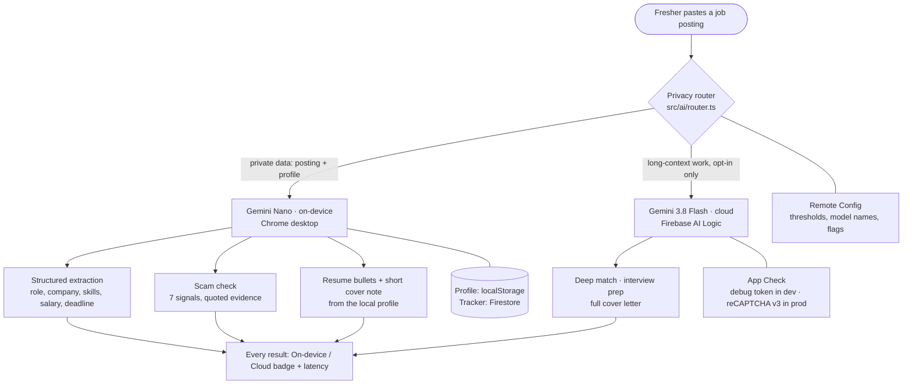

# Latchkey

**A fresher job-hunt copilot where your private data is drafted on your own device, and only the heavy work goes to the cloud.**

Built for [#BuildHybridAI 2026](https://firebasehybridaihackathon.devpost.com) (Devpost, Google). Free of charge. No account needed.

## The problem

Freshers in India applying to remote jobs send generic applications, get filtered by ATS systems, and face scam listings that demand fees or recruit only over Telegram and WhatsApp. Their CV is sensitive personal data, and most AI job tools ship it to a server before doing anything.

## The idea: privacy-driven hybrid inference

Routing is driven by privacy, not just availability.

- **On-device (Gemini Nano, Chrome desktop)** — everything that touches your own private data runs locally and never leaves the device: job-post extraction, scam detection, tailored resume bullets, and the short cover note. Instant, free, offline-capable.
- **In the cloud (Gemini via Firebase AI Logic)** — only the long-context, heavy work: deep match analysis across the full profile, interview questions with model answers, and the long-form cover letter. The job description is public text; your CV is not sent for these calls unless you explicitly opt in.
- **Every AI result carries a visible badge** — On-device or Cloud — plus latency, so the hybrid split is demonstrable in one glance. If Nano is unavailable, on-device tasks fall back to the cloud and the badge flips. If you are offline, the cloud features pause and the on-device ones keep working.

## How Firebase AI Logic is used

The app imports Firebase AI Logic from `firebase/ai` and calls it at runtime in `src/ai/engine.ts`:

```ts
import { getAI, getGenerativeModel, GoogleAIBackend, InferenceMode } from 'firebase/ai';

const ai = getAI(app, { backend: new GoogleAIBackend() });
const model = getGenerativeModel(ai, {
  mode: InferenceMode.PREFER_ON_DEVICE, // or PREFER_IN_CLOUD
  inCloudParams: { model: 'gemini-3.8-flash' },
});
await model.initializeDeviceModel(onProgress); // after a user gesture
const result = await model.generateContent(prompt);
result.response.inferenceSource; // 'on_device' | 'in_cloud'
```

(Note: the Firebase JS SDK v13 exposes AI Logic as `firebase/ai`, not the older `firebase/ai-logic` path.)

Other Firebase products: **App Check** (debug provider in dev, reCAPTCHA v3 in production — required by AI Logic), **Remote Config** (routing thresholds, model names, feature flags), **Authentication** (anonymous by default, optional Google sign-in), **Firestore** (application tracker), **Hosting** (Spark free tier).

Until the Firebase project is connected, the app runs against a deterministic **mock AI layer** with the same routing, badges, and latency display, labelled "demo" so it never pretends a real model ran. The mock uses the same rule sets the on-device model is prompted with.

## Architecture: how the hybrid routing works



Routing is privacy-driven. A task runs on-device when it touches the user's own private data, and in the cloud only when the work needs long context and the user has opted in:

| Task | Where it runs | Why |
|---|---|---|
| Job-post extraction | On-device (Gemini Nano) | Reads the posting; structured JSON output |
| Scam check | On-device (Gemini Nano) | Instant verdict from 7 signals, quoted evidence |
| Resume bullets | On-device (Gemini Nano) | Built from the locally stored profile |
| Short cover note | On-device (Gemini Nano) | Built from the locally stored profile |
| Deep match analysis | Cloud (Gemini 3.8 Flash) | Long context: full profile + full posting, opt-in |
| Interview prep | Cloud (Gemini 3.8 Flash) | Long context with model answers, opt-in |
| Full cover letter | Cloud (Gemini 3.8 Flash) | Long-form writing, opt-in |

Fallbacks, all visible in the badge: if Nano is unavailable, on-device tasks fall back to the cloud and the badge flips to Cloud; a posting longer than 6,000 characters goes to the cloud even for on-device tasks; offline, cloud features pause and on-device features keep working. Transient cloud capacity errors (HTTP 500/503) are retried twice with backoff; auth, App Check, and model errors fail fast and are shown, never silently retried.

The request flow for a real call: `JobAnalyzer` → `HybridEngine.generate()` (`src/ai/engine.ts`) → `routeTask()` picks the mode → `getGenerativeModel(ai, { mode: InferenceMode.PREFER_ON_DEVICE | PREFER_IN_CLOUD, inCloudParams: { model: 'gemini-3.8-flash' } })` → `initializeDeviceModel()` after the user clicks "Set up on-device AI" → `generateContent()` → `response.inferenceSource` drives the badge. App Check is initialised at startup (`src/appcheck.ts`): the registered debug token in dev, reCAPTCHA v3 in production. Remote Config supplies the thresholds (cloud minimum length, model names, photo-upload flag) so routing can be tuned without a redeploy.

Note: the cloud model is `gemini-3.8-flash`. The original plan named `gemini-2.5-flash`, but Google retired that model for new projects; the API itself returns a 404 naming `gemini-3.8-flash` as the replacement, and the code was switched on 2026-11-17 (see `VERIFICATION.md`).

## Features

1. Paste a job posting, or upload a photo of one (on-device multimodal input).
2. Structured extraction: role, company, must-have and nice-to-have skills, salary hint, location and remote eligibility, deadline.
3. Scam check: fee demands, Telegram/WhatsApp-only recruiters, free-Gmail "HR", MLM / commission-only, vague form-filling, unrealistic pay. Green / amber / red verdict with the exact quoted evidence.
4. Tailored resume bullets and a short cover note, generated on-device from your stored profile.
5. Deep match analysis (fit score, strengths, gaps, what to learn next), interview prep, and a full cover letter in the cloud, only with your opt-in.
6. Application tracker: Saved / Applied / Interview / Offer / Rejected, with deadlines.
7. Profile stored locally on-device by default. A fictional sample profile and two sample postings let anyone try the full loop with one click and no personal data.

## Tech stack

Vite + React 19 + TypeScript + Tailwind CSS 4, Firebase 13 (AI Logic, App Check, Remote Config, Auth, Firestore, Hosting). Vitest for unit tests. No API keys in the repo.

## Run it

```bash
npm install
npm run dev        # local dev server
npm test           # unit tests (33 tests: scam rules, extraction, routing, prompts, engine retries, App Check, Firebase config)
npm run build      # production build to dist/
```

## Connect Firebase (for the real AI path)

The live project is `latchkey-hybrid-ai` (Gemini Developer API backend, no billing). The web config and the App Check debug token live in `.env.local`, which is gitignored and never committed.

1. Create a Firebase project at [console.firebase.google.com](https://console.firebase.google.com).
2. Run the AI Logic guided setup with the **Gemini Developer API** backend (no billing).
3. Register the web app and enable App Check.
4. Copy `.env.example` to `.env.local` and fill in the web config values plus the App Check debug token (App Check > Manage debug tokens).
5. For the production build, register a **reCAPTCHA Enterprise site key** in the Firebase console (App Check > reCAPTCHA Enterprise) and set `VITE_RECAPTCHA_V3_SITE_KEY` in `.env.local`. Without it the hosted demo cannot attest App Check; the debug token is dev-only and never ships in the production bundle.
6. Deploy: `npm run build && firebase deploy --only hosting`.

With no `.env.local`, the app runs in demo mode against the mock layer.

### Verify the real AI path (no browser needed)

```bash
node scripts/smoke-real-ai.mjs    # SDK cloud call; expects a 401 without App Check (enforcement is on)
node scripts/smoke-appcheck.mjs   # debug-token exchange + attested cloud call; must print SMOKE-APPCHECK: PASS
```

The attested smoke test proves the project, the API key, the debug-token registration, App Check enforcement, and the cloud model all work. The on-device (Gemini Nano) path needs a real Chrome 139+ desktop with Nano downloaded; it cannot run in this VM.

## Project structure

```
src/
  ai/            Hybrid inference layer: engine, router, prompts, mock, rules
  config/        Firebase config, Remote Config
  store/         Profile (local-first) and tracker stores
  data/          Fictional sample profile and job postings
  ui/            React components (analyzer, tracker, profile editor)
  auth.ts        Anonymous auth, optional Google sign-in
  appcheck.ts    App Check (debug in dev, reCAPTCHA v3 in prod)
```

## License

Apache-2.0. See [LICENSE](LICENSE).
